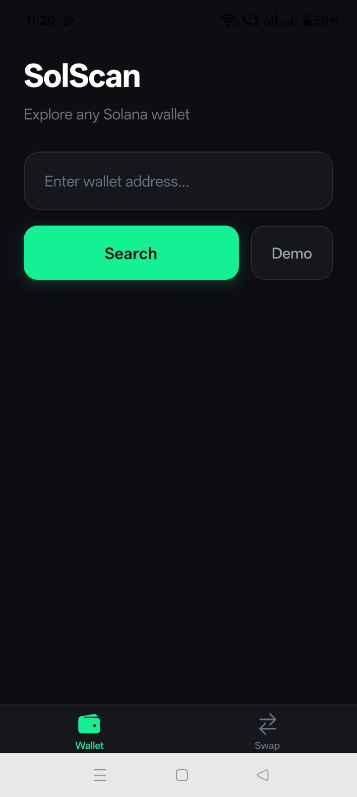
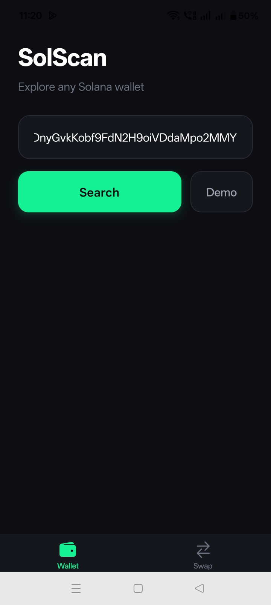
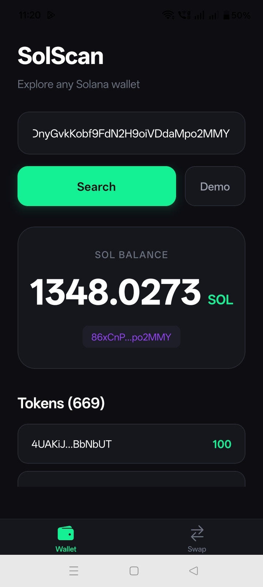
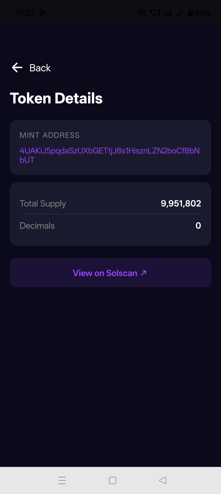
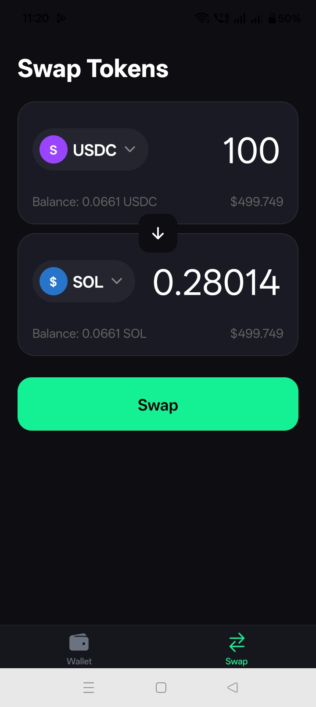

# Sol-Scan

A React Native app to explore Solana wallets. View SOL balance, token holdings, and recent transactions for any wallet address.

## Demo

<p align="center">
  
  
  
</p>
<p align="center">
  
  
  <!--  -->
</p>

## Features

- View SOL balance
- List token holdings
- Recent transaction history
- Direct links to Solscan explorer

## Setup

```bash
npm install
```

## Run

```bash
# iOS
npx expo run:ios

# Android
npx expo run:android

# Development server
npx expo start
```

## Tech

- React Native + Expo
- Solana JSON-RPC (no SDK required)
